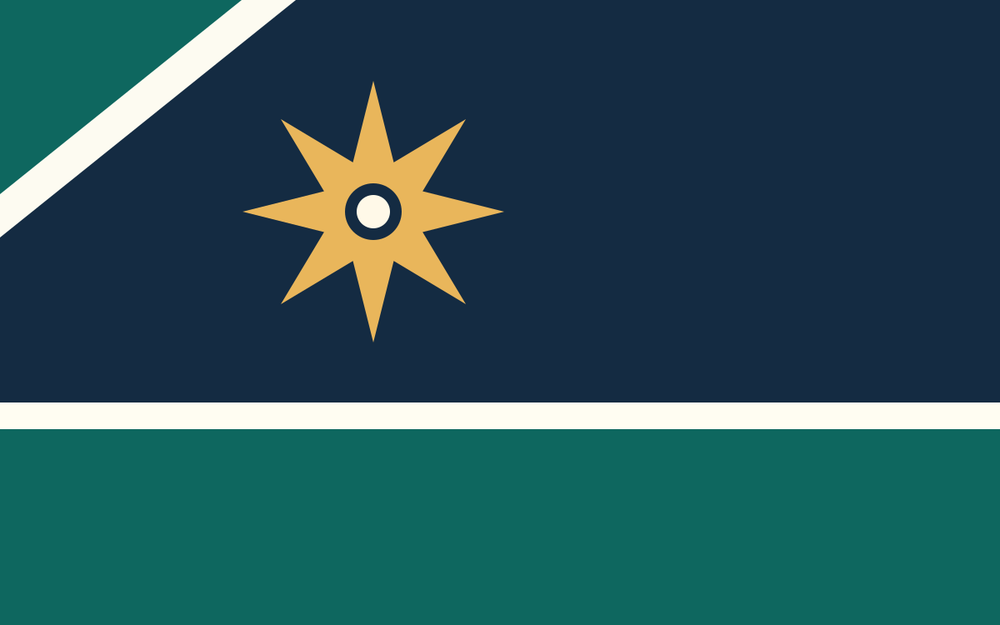
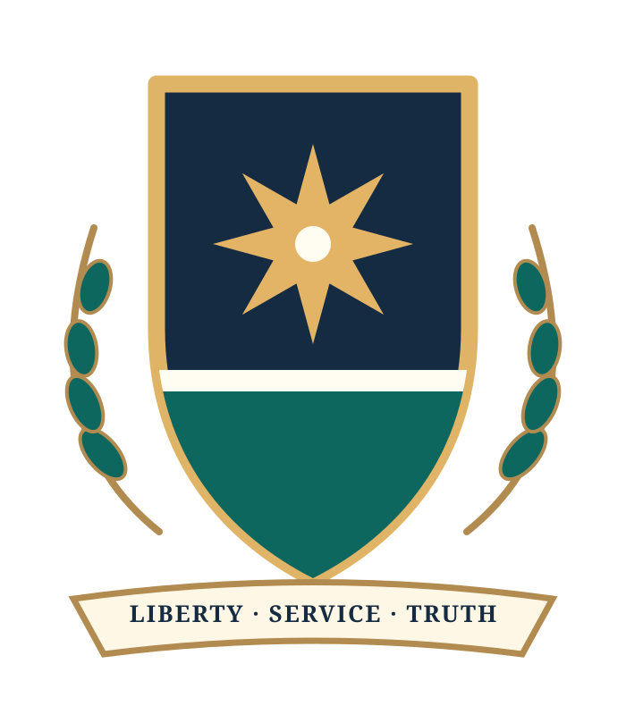

# Proposed national symbols

**Consultation only — nothing here has been adopted by a constitutional vote.**

## Flag proposal A

The **Founding Star** flag uses deep navy (duty and public trust), teal (community and renewal), ivory (equality) and an eight-point golden star (hope and common purpose). The composition is a new design for Parristan and does not copy an existing national flag.

- [Editable SVG file](../docs/assets/flag-proposal.svg)
- [Open public design discussion](https://github.com/Parris-Tech-Services/RepublicOfParristan/issues/2)

## Coat of arms proposal A

The proposed civic emblem echoes the flag, combines a shield with stylised branches and carries the suggested motto:

**LIBERTY · SERVICE · TRUTH**

This emblem is not an official government seal, registered heraldic device or evidence of sovereign statehood.

- [Editable SVG file](../docs/assets/arms-proposal.svg)

## Anthem proposal

[“Together Stand” — proposed original lyrics](ANTHEM_PROPOSAL.md).

No melody recording has been made or adopted. An original musical setting can be commissioned or developed after consultation.

## Adoption

A future legitimate assembly should publish alternatives, allow public discussion, verify design rights and then record an authorised vote. The Gazette will only call a symbol *official* after recording evidence of its adoption.
